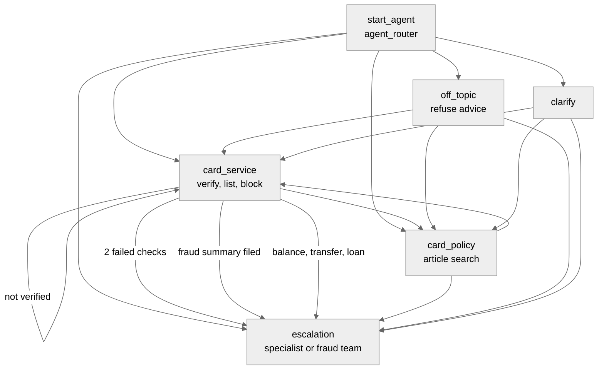

# Agent Spec: Retail_Banking_Agent

## Purpose & Scope

Ascend Bank customers can block a lost or stolen card at any hour without waiting for the call centre. The agent verifies the account holder, shows only safe card details, blocks the chosen card, and answers three card-policy articles. Balances, transfers, loans, financial advice, and unblocking are outside what this agent completes.

## Behavioral Intent

- The customer is an account holder. Protected card actions require a registered email and date of birth that match one Contact.
- A failed match uses one message and does not say which value was wrong. The first reply asks for the registered email and the date of birth together, and the date must be entered as DD/MM/YYYY. Any other date format is sent back for re-entry and is not compared and does not count as a failed match. Two failed matches hand the conversation to the escalation topic, which offers a specialist before the transfer.
- Card lookup and block actions receive the Contact Id stored by verification. The customer cannot supply that id.
- Cards are shown as type, last 4 digits, and status. A full card number is never stored or repeated. Long digit strings in a fraud summary are redacted before the Case is saved.
- If more than one card matches, the agent asks which card and the block action changes nothing.
- Blocking an Active card sets Status to Blocked and creates a Case with Type = Card Block.
- The agent cannot set a card back to Active. Unblocking is done in the Ascend Bank app or at a branch.
- A lost card plus an unrecognised transaction in the same chat blocks the card, creates a Fraud Report Case with the customer's summary, and escalates to the fraud team. The agent does not investigate the transaction.
- Balances, transfers, and loans escalate. Financial and investment advice is refused.
- Policy answers come from the published articles Lost or stolen card, Replacement card timelines, and Reporting fraud.
- The Agentforce Data Library service returned an internal error in this org, so the agent searches those articles directly instead of using a `knowledge:` block.

## Subagent Posture

| Subagent | Posture | Why this posture? | Deterministic controls |
|----------|---------|-------------------|------------------------|
| agent_router | scripted | Several domains need different authority and escalation | HyperClassifier, transition only |
| card_service | mixed | The model collects the card the customer means; verification and ownership stay in code | Verification gate, pinned Contact Id, two-failure handoff, block action refuses an ambiguous or already blocked card |
| card_policy | agentic | Article questions need a search, then a normal answer | Answer only from the search result |
| escalation | scripted | The handoff itself must happen | Says the next step, then calls escalate on the following turn. A fraud handoff first says the card is blocked and that the customer is being transferred to the support team |
| off_topic | agentic | Refusal is a judgment about advice and scope | No account actions |
| clarify | agentic | A vague greeting only needs a question | No account actions |

## Subagent Map

## Variables

| Variable | Type / Default | Trusted Writer | Named Consumer | Cause | Reset |
|----------|----------------|----------------|----------------|-------|-------|
| `customer_verified` | mutable boolean = False | `verify_customer.verified` | `available when` on list, block, and fraud | authorization | Set false when verification fails |
| `VerifiedCustomerId` | mutable string = "" | `verify_customer.contactId` | Contact Id input on list, block, and fraud | authorization | Cleared when verification fails |
| `failed_attempts` | mutable number = 0 | `verify_customer.failedAttempts` | `available when` and the two-failure transition | authorization | Set to 0 after a match |
| `specialist_offered` | mutable boolean = False | escalation `after_reasoning` | gates the transfer action | The test records the topic `escalation` only when that turn does not call escalate | Stays true after the offer |
| `fraud_handoff_announced` | mutable boolean = False | escalation `after_reasoning` | gates the fraud transfer | The transfer action replaces the agent's sentence with the platform transfer line, so the card-blocked sentence must be its own turn | Stays true after the announcement |
| `fraud_case_number` | mutable string = "" | block or fraud-report output | `after_reasoning` transition to escalation, and the handoff message | Observed failure: the model confirmed the fraud case and did not hand off | Stays for the rest of the conversation |
Linked Messaging Session variables stay on the service agent. The chosen card, the fraud summary, and ordinary dialogue stay in conversation history.

## Actions

### verify_customer (card_service)

- **Target:** `apex://VerifyAscendCustomer`
- **Status:** NEEDS CREATION

#### Inputs

| Name | Type | Required | Source |
|------|------|----------|--------|
| email | string | Yes | Customer |
| dateOfBirth | string | Yes | Customer, only after it is written as DD/MM/YYYY |
| priorFailedAttempts | number | No | `failed_attempts` |

#### Outputs

| Name | Type | Visible to User? | Notes |
|------|------|------------------|-------|
| verified | boolean | No | Sets `customer_verified` |
| contactId | string | No | Hidden from the model and stored for later actions |
| customerName | string | Yes | Greeting only |
| failedAttempts | number | No | Sets `failed_attempts` |
| message | string | Yes | Asks for DD/MM/YYYY when the format is wrong. A mismatch does not reveal which field failed |

### list_cards (card_service)

- **Target:** `apex://GetAscendCustomerCards`
- **Status:** NEEDS CREATION
- **Available when:** `customer_verified == True`

#### Inputs

| Name | Type | Required | Source |
|------|------|----------|--------|
| contactId | string | Yes | `VerifiedCustomerId` |

#### Outputs

| Name | Type | Visible to User? | Notes |
|------|------|------------------|-------|
| cardCount | integer | No | Used to decide whether to ask which card |
| cardsSummary | string | Yes | Type, last 4 digits, and status only |

### block_card (card_service)

- **Target:** `apex://BlockAscendCard`
- **Status:** NEEDS CREATION
- **Available when:** `customer_verified == True`

#### Inputs

| Name | Type | Required | Source |
|------|------|----------|--------|
| contactId | string | Yes | `VerifiedCustomerId` |
| last4 | string | No | Customer, when they name a card |
| cardType | string | No | Customer, Debit or Credit |
| unrecognisedTransactionSummary | string | No | Customer words, only when they report an unrecognised transaction |

#### Outputs

| Name | Type | Visible to User? | Notes |
|------|------|------------------|-------|
| success | boolean | No | Active card was set to Blocked |
| alreadyBlocked | boolean | No | No status change and no unblock |
| needsChoice | boolean | No | More than one match; nothing changed |
| blockCaseNumber | string | Yes | Case Type = Card Block |
| fraudCaseNumber | string | Yes | Case Type = Fraud Report, when a summary was passed |
| message | string | Yes | Safe result, including the unblock refusal |

### report_fraud (card_service)

- **Target:** `apex://CreateAscendFraudReport`
- **Status:** NEEDS CREATION
- **Available when:** `customer_verified == True`

Used when the card is already blocked and the unrecognised transaction was not included in the block action. The action writes a Case and does not look up a transaction.

### search_card_articles (card_policy)

- **Target:** `apex://SearchAscendCardKnowledge`
- **Status:** NEEDS CREATION

Searches only the three published card articles. The answer is limited to the returned text.

## Sample data

One customer, Jordan Hale, `jordan.hale@ascendbank.example`, date of birth 3 November 1988, with two cards:

- Debit ending 4412, Active
- Credit ending 7780, Blocked

## Release

Stay in draft. Do not publish or activate until the preview paths are accepted.
